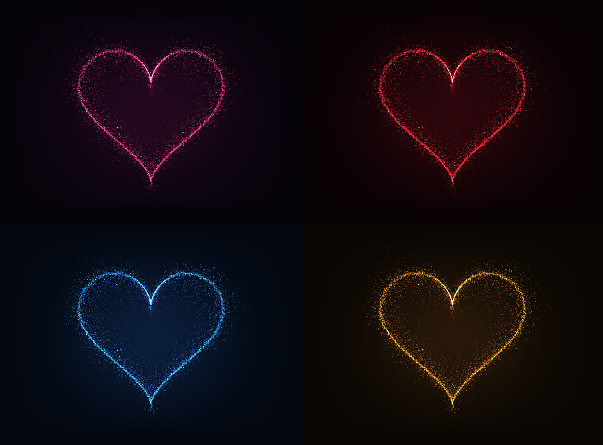

# 星尘之心 · Neon Stardust Heart ❤️


-ff4d79)


一个**零第三方依赖**（仅使用 Python 标准库 `tkinter` + `math`）实现的像素级光学加法辉光（Additive RGB Bloom）星尘动态爱心渲染项目。单帧实时渲染 **7,800+ 颗**发光星尘粒子，无需安装任何外部库即可开箱运行。

<p align="center">
  
</p>

## ✨ 视觉与算法亮点

1. **等弧长重采样心形曲线（Equal-Arclength Heart Curve）**  
   对经典笛卡尔参数心形线做弧长积分与等距重采样，彻底消除传统参数采样在顶部凹口与底部尖端处的点密度堆积，使整条 ❤️ 弧线饱满均匀。
2. **原生 P6 帧缓冲加法辉光（Additive RGB Bloom）**  
   直接操作二进制 RGB 帧缓冲实现光学叠加混合——粒子交叠密集处自动由深绯红平滑过渡至樱花粉与璀璨星白。
3. **双峰真实心跳律动（Lub-Dub Heartbeat）**  
   双高斯脉冲模拟真实心脏“收缩—微弹—舒张”节律，并带有由内腔向外缘传导的相位波纹与向外荡开的心形星雾涟漪。
4. **多重浪漫动态层次**  
   天鹅绒指数扩散内腔 + 3×3 柔光主轮廓 + 双向游走的心形流光彗星 + 十字星芒闪烁 + 升腾流萤 + 鼠标仙女棒星尘拖尾。

## 🎨 内置 4 套高定发光主题

点击画面或按下空格键，即可在 **绯樱星尘（Sakura Rose）**、**炽恋真红（Ruby Flame）**、**星河蓝钻（Starry Sapphire）**、**鎏金香槟（Champagne Gold）** 四套主题间实时切换：

<p align="center">
  
</p>

## 🚀 快速开始

无需 `pip install` 任何依赖（需 Python 自带 `tkinter` 支持）：

```bash
git clone https://github.com/mochen9914/heart_demo.git
cd heart_demo
python3 heart_art.py
```

## 🎮 交互操作

| 操作 | 效果 |
| :--- | :--- |
| **滑动鼠标** | 挥洒轻盈上浮的发光星尘火花 |
| **`Space` 空格键 / 鼠标左键点击** | 切换 4 套发光配色并激发一道心形扩散波 |
| **`P` 键** | 定格 / 继续当前画面 |
| **`Esc` 键** | 退出程序 |

## 📄 开源协议

本项目基于 [MIT License](LICENSE) 开源。欢迎 Star ⭐、Fork 与二次创作！
